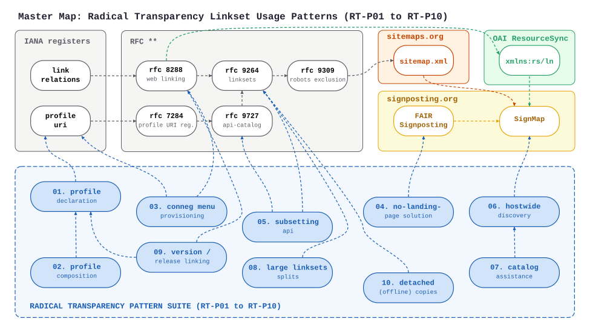
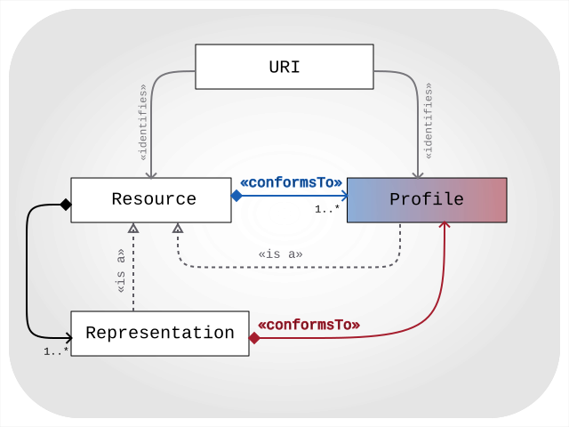

# Linkset Usage Patterns (RT-P01 to RT-P10): Master Overview

## 1. Introduction: Making Interoperability Measurable and Accountable

"When public money is invested in interoperability across projects, how can we guide its spending without preventing innovative evolution and objectively demonstrate what has actually been achieved?"

Asking the question is quite confrontational, as it mostly points to the fact that no holistic answer to quantify progress in interoperability is readily available. We believe the composing parts are, and many different parties are working independently towards fine-tuning them. Through the narrative of "Radical Transparency" we aim to bridge those independent efforts into a cohesive whole structured as three sequential, interdependent steps:
1. **Declare.** One central, solid mechanism to make structural navigation paths and technical standardisation choices explicit, findable, and machine-actionable.
2. **Verify.** Opening up to formal approaches to describe the details of those declared choices, so conformance can be independently and automatically verified.
3. **Quantify.** Leading towards an objective measurement of interoperability—allowing stakeholders to track verification outcomes and adoption trends, reliably compare ex-ante and ex-post states, and guide future investments.

The goal of this document is to lay down a proposal to formalise the «Declare» step (the foundational layer) using the 10 linkset usage patterns detailed below. It also touches upon a selection of existing standards and techniques it builds upon, and references relevant literature that inspired the work.


## 2. Context and Problem Statement

Today data exchange remains heavily constrained by **"assumed compatibility"** — a hopeful but fragile reliance on the belief that systems (and the developers behind them) "inside the room" share the same implicit schemas, coordinate reference systems, vocabularies, and units. When these digital assets are consumed by autonomous crawlers, cross-domain harvesters, or AI agents outside that room, these safe boundaries are challenged, and this belief system collapses, resulting in statistical guesswork, broken chains, and semantic drift.

> **Technical Definition:**  
> **Radical Transparency's Declare Step (Foundational Layer)** is an architectural discipline requiring digital resources and services to explicitly declare their structural, semantic, and relational conformity directly within the web's transport and discovery layers (via HTTP headers, RFC 9264 linksets, and sitemaps). Instead of forcing consumers into statistical guesswork, data producers declare machine-verifiable conformity; in return, the burden of contextualization, human interface design, and client-side rendering shifts to user agents and client applications.

This practice has always been part of the OSI-stack practical design: each layer clearly indicating the type of information it transports, avoiding all guesses about the next layer to select and activate for processing. For too long the web layer has been mistaken as the final presentation and application layer: assuming all further processing will be done by knowledgeable (human) experts. We argue however that the many Web APIs make the HTTP layer a transport layer itself, and that experts too can use additional hints.

For the foundational philosophy, the historical navigation analogies, and the detailed exploration of the **10 Paradoxes of Interoperability**, refer to the position paper:

> **Position Paper Reference:**  
> Portier, M., Ulrichts, B., Decruw, C., Baggali, H., Nielandt, J., Goley, J., Van Maldeghem, L., Exter, K., Delvenne, C., & Tyberghein, L. (2026). *Radical Transparency: A Vision for Scalable Interoperability*. Flanders Marine Institute (VLIZ).  
> Available at: [https://open-science.vliz.be/papers/2026-radical-transparency-position/2026-radical-transparency-position.pdf](https://open-science.vliz.be/papers/2026-radical-transparency-position/2026-radical-transparency-position.pdf)

This document offers a "master overview"—an entry point and operational map for the **10 Linkset Usage Patterns (RT-P01 to RT-P10)** that form the "Declare" step of the Radical Transparency concept. Far from inventing novel protocols, these patterns are governed by the principle of **"Maximum Boredom"**—solving complex federated interoperability challenges by applying mature, stable, and underutilized web standards.

---

## 3. Foundational Specifications

The linkset patterns described here rely on existing standards and prior work. They borrow from and extend published inspirational material.

As a quick reminder we round up and describe the core parts we rely upon, ensuring they get properly acknowledged while bringing all readers to a shared level of understanding.


### IETF RFCs (The Protocol Backbone)
*   **[RFC 8288 (Web Linking)][RFC 8288]**: Establishes the typed link model (`anchor`, `relation-type`, `target`, and target attributes) serialized in HTTP `Link` headers. 
*   **[RFC 6906 (The 'profile' Link Relation Type)][RFC 6906]**: Provides the standard bootstrapping relation to signal conformity to a specification or profile URI.
*   **[RFC 9264 (Linkset: Media Types and a Link Relation Type)][RFC 9264]**: Defines a pure textual (`application/linkset`) and JSON (`application/linkset+json`) serializations for sets of links, enabling reuse and efficiency. These function as local "maps" describing the relationships between resources.
*   **[RFC 9727 (api-catalog)][RFC 9727]**: Standardizes host-wide API contract discovery via `/.well-known/api-catalog`.
*   **[RFC 5829 (Version Navigation)][RFC 5829]**: Standardizes lifecycle relations (`latest-version`, `predecessor-version`, `version-history`) to make resource evolution machine-traversable.
*   **[RFC 6573 (Item and Collection Link Relations)][RFC 6573]**: Defines `item` and `collection` for modeling structural membership and pagination.
*   **[RFC 9309 (Robots Exclusion Protocol)][RFC 9309]**: Standardizes `/robots.txt` as the entry gate to web resources and sitemaps.

### Web Discovery & Semantics
*   **[sitemaps.org Protocol][sitemaps-org]**: Creates an optimised, high-volume, host-wide URL discovery mechanism as an extension to `robots.txt`.
*   **[OAI ResourceSync (ANSI/NISO Z39.99)][resourcesync]**: Extends sitemaps with the `xmlns:rs` namespace and `<rs:ln>` elements to inject typed link relations directly into the XML feeds.
*   **[FAIR Signposting][signposting] & [SignMap][signmaps]**: Defines a minimal, scholarly-focused set of usage patterns of link relations (`cite-as`, `describedby`, `item`, `type`, `license`, `author`).
*   **[Schema.org] & [W3C DX-PROF][dx-prof]**: Provides the formal vocabularies (`schema:hasPart`, `prof:isProfileOf`) used to structure profile composition and description.


### IANA Registries (The Vocabulary of the Web)
*   **[IANA Link Relations Registry][IANA relreg]**: Standardized relation types (`profile`, `alternate`, `describedby`, `item`, `collection`, `cite-as`, `latest-version`, `predecessor-version`, `api-catalog`).
*   **[IANA Profile URIs Registry][IANA profreg]**: Formal registry for globally unique profile identifiers established under [RFC 7284].


This is how we see these leading up to our usage patterns:

1. The core mechanism of [web-linking][RFC 8288] was detached from its HTML birth-cradle and formalized so it can be applied through HTTP Link headers to any resource, regardless of the representations it produces.
2. For purposes of efficiency, simplicity and reuse, the [Linkset][RFC 9264] format delegates the publication of link relations from individual resources to Linkset resources.
3. Useful (and thus reusable) link relations get claimed and assigned over various new IETF RFCs, as well as registered in the [IANA Link Relations Registry][IANA relreg].
4. Among those, [the 'profile' link relation][RFC 6906] provides the bootstrap "conformance declaration strategy" for the Declare step of Radical Transparency.
5. Centralised discovery mechanisms introduced by [sitemaps.org][sitemaps-org] get extended with the [OAI ResourceSync][resourcesync] namespace to allow disclosing directly the Link-relation on a host level. Thus removing the need for many detailed harvesting calls in the discovery process.
6. The lightweight [FAIR Signposting][signposting] guidelines provide a first set of linkset patterns for a specific domain (scholarly resources).


Note that the above could suggest an order between these specifications and an overall intention that does not have to be factually or historically correct. No larger intent or conspiracy is needed for these individual specifications to become useful building blocks of our patterns. The sequential build-up should only be seen as a narrative construct that helps towards a natural understanding of the motivating thought train behind Radical Transparency.

---

## 4. The Master Map: Interlocking Patterns

The Radical Transparency framework organizes 10 modular patterns across three operational domains: **Conformity & Identity**, **Content & API Negotiation**, and **Host-Wide Discovery & Federation**, supplemented by a downstream client-side extension pattern for data at rest.

The diagram below maps how these ten patterns interlock and build upon IANA registers, core IETF RFCs, Sitemaps, and FAIR Signposting:



### The 10 Patterns at a Glance

| Pattern ID | Pattern Name | Goal & Technical Function | Foundational Standards | 
| :--- | :--- | :--- | :--- | 
| **RT-P01** | [Profile Declaration][RT-P01] ([PDF](01-profile-declaration.pdf)) | Allows a resource to explicitly declare its structural and semantic conformity using a global profile URI via `rel="profile"`. | [RFC 6906], [RFC 7284], [dx-prof] | 
| **RT-P02** | [Profile Composition][RT-P02] ([PDF](02-profile-composition.pdf)) | Enables recursive inheritance of profile guarantees, allowing agents to infer broad compliance from specific declarations via `schema:hasPart`. | Schema.org (`hasPart`), [RFC 6906] | 
| **RT-P03** | [Content Negotiation Menu][RT-P03] ([PDF](03-content-negotiation-menu.pdf)) | Exposes the complete "menu" of available representations (formats, schemas, languages) alongside identity anchors for redirects. | [RFC 8288], [RFC 9264] (`rel="alternate"`, `rel="self"`) |
| **RT-P04** | [No Landing Page Solution][RT-P04] ([PDF](04-no-landing-page-solution.pdf)) | Restores direct machine access to core data payloads by routing PIDs to content, treating the HTML landing page as just another metadata variant. | [RFC 8574] (`rel="cite-as"`), [RFC 8288], [signposting] |
| **RT-P05** | [Subsetting API][RT-P05] ([PDF](05-subsetting-api.pdf)) | Anchors dynamic API queries and filtered slices back to their parent API endpoint (`rel="collection"`), which in turn links to the source dataset PID (`rel="cite-as"`) and the API service contract (`rel="api-catalog"`, `rel="service-desc"`). | [RFC 9727], [RFC 6573], [RFC 8288], [OGCAPI] |
| **RT-P06** | [Hostwide Resource Discovery][RT-P06] ([PDF](06-hostwide-discovery.pdf)) | Augments standard web crawling paths (`robots.txt` $\rightarrow$ `sitemap.xml`) with typed link relations using ResourceSync `<rs:ln>` or SignMaps. | [RFC 9309], [sitemaps-org], [resourcesync], [signmaps] |
| **RT-P07** | [Catalog Assistance][RT-P07] ([PDF](07-catalog-assistance.pdf)) | Delegates large-scale asset discovery from flat sitemaps to specialized catalog and register entry points (DCAT, OGC Records, STAC). | [resourcesync], [RFC 9727], [OGCAPI] |
| **RT-P08** | [Large Linkset Split-up][RT-P08] ([PDF](08-large-linksets.pdf)) | Decomposes massive metadata link trees into smaller, cacheable, and lazy-loaded linkset fragments using `rel="item"` and `rel="collection"`. | [RFC 9264], [RFC 6573] |
| **RT-P09** | [Release Linking][RT-P09] ([PDF](09-release-links.pdf)) | Connects mutable conceptual resources ("latest") to immutable release snapshots (DOIs) and maps historical lineage. | [RFC 5829], [RFC 8574], [RFC 7089] |
| **RT-P10** | [Detached Local Storage][RT-P10] ([PDF](10-detached-local-storage.pdf)) | *Client-Side Extension:* Preserves web identity, licensing, and profile context for digital assets stored at rest via sidecar linksets and OS extended attributes. | [RFC 9264] (Relative Linksets), OS `xattr` |


---

## 5. The Semantic Bridge: Linksets vs. RDF Triples

A common question from Semantic Web practitioners is: *Why use RFC 9264 Linksets instead of standard RDF serializations (Turtle, JSON-LD, DCAT)?*

### Why Linksets are not General Triples
1.  **Protocol-Level Lightness:** Linksets operate at the transport and discovery layer (HTTP Layer 7). An agent or reverse proxy can inspect relations and negotiate content **before** downloading, parsing, or loading large graphs into memory.
2.  **Strictly Scoped Semantics:** General RDF graphs allow arbitrary statements, complex blank-node structures, and property paths. Linksets enforce a constrained, deterministic tuple: `(anchor, relation, target, attributes)`.
3.  **Transport Independence:** A linkset can be delivered via HTTP `Link` headers, as an independent sidecar document (`application/linkset+json`), embedded in HTML `<link>` elements, or wrapped in XML sitemaps (`<rs:ln>`).

### Mapping Linksets to RDF Triples
Still, the information expressed in link-relations can easily be captured and expressed as RDF triples. This allows the Semantic Web community to leverage its rich toolset for working with the patterns described in this document.


In general we recommend **not** doing so in the direct and naive way of:

$$\langle \text{anchor} \rangle \quad \langle \text{relation-URI} \rangle \quad \langle \text{target} \rangle \; .$$

Instead, while [RFC 9264][RFC 9264] (Appendix A) illustrates JSON-LD lifting with an example `@context`, neither RFC 8288 nor RFC 9264 defines a normative RDF reification vocabulary for web links and their target attributes. To avoid inventing non-existent terms under existing W3C namespaces (such as `xhtml:`), Radical Transparency introduces a lightweight reification vocabulary under `https://radical-transparency.net/ns/weblink#` (`rtwl:`) to factually record observed links without losing target attributes (`type`, `profile`, `language`, etc.):

```turtle
@prefix rtwl: <https://radical-transparency.net/ns/weblink#> .

[] a rtwl:WebLink ;
   rtwl:anchor <https://example.org/resource> ;
   rtwl:rel "alternate" ; # IANA registered token, or URI <...> for extension relations
   rtwl:href <https://example.org/resource.ttl> ;
   rtwl:attribute [
       a rtwl:TargetAttribute ;
       rtwl:key "type" ;
       rtwl:value "text/turtle"
   ] , [
       a rtwl:TargetAttribute ;
       rtwl:key "profile" ;
       rtwl:value <https://example.org/profiles/marine-ctd-v2>
   ] .
```

This is a factual representation of the observed link relations in the wild. Depending on the use case, application, or higher-level business logic, this basic representation can be reasoned upon to derive more complex equivalences.

### Spontaneous Equivalence & Reasoning

Specifically in relation to our own proposed patterns, here are a number of equivalences we have defined:

```turtle
# Example: Link-Relation patterns as RDF
@prefix dcterms: <http://purl.org/dc/terms/> .
@prefix schema:  <http://schema.org/> .
@prefix iana:    <http://www.iana.org/assignments/relation/> .

# 1. Profile conformity (RT-P01)
<https://data.example.org/dataset-123>
  dcterms:conformsTo <https://example.org/profiles/marine-ctd-v2> .

# 2. Profile composition inference (RT-P02)
<https://example.org/profiles/marine-ctd-v2>
  schema:hasPart <https://example.org/profiles/base-tabular-v1> .

# 3. Persistent identification (RT-P04)
<https://data.example.org/dataset-123>
  dcterms:identifier <https://doi.org/10.5072/example-doi> .

# 4. Structural subsetting (RT-P05)
<https://data.example.org/api/subset?bbox=51,2,52,3>
  iana:collection <https://data.example.org/api/> .
<https://data.example.org/api/>
  dcterms:identifier <https://doi.org/10.5072/example-doi> .
```


To facilitate cross-stack interoperability, machines can apply spontaneous equivalence rules across link relations and core ontologies:

| Link Relation (`rel`) | Primary RDF / OWL Predicate | Target Attribute Mapping | Semantic & Entailment Rule |
| :--- | :--- | :--- | :--- |
| `profile` | `dcterms:conformsTo` | `prof:hasProfile` | Conformity statement: Resource guarantees compliance with the identified profile URI. |
| `http://schema.org/hasPart` | `schema:hasPart` | `prof:isProfileOf` | Transitive profile inheritance:  <br>$(A \text{ conformsTo } P_1) \land (P_1 \text{ hasPart } P_2) \implies (A \text{ conformsTo } P_2)$ |
| `cite-as` | `dcterms:identifier` | `schema:identifier` | Canonical citation anchor; binds representations back to their persistent identifier (PID/DOI). |
| `describedby` | `wdrs:describedby` | `rdfs:seeAlso` | Points to a descriptive metadata representation of the anchor resource. |
| `alternate` | `iana:alternate` | `dcterms:format`, `dcterms:language` | Representation variant available through content negotiation. |
| `collection` / `item` | `iana:collection` / `iana:item` | `rdfs:member`, `dcat:catalog` | Structural aggregation and containment for files, subsets, and catalogs. |
| `latest-version` | `iana:latest-version` | `dcat:hasCurrentVersion` | Lineage pointer resolving the Series/Release paradox. |

---

## 6. Profiling Resources vs. Representations

A frequent source of ambiguity in web architecture—and in the reading of [RFC 6906] itself—is *what* actually conforms to a declared profile: the abstract **Resource** or a specific **Representation** of that resource?



As captured in the domain model above, a single conceptual **Resource** (identified by its URI) can be materialized through multiple (`1..*`) **Representations** (e.g., a dataset served as Turtle, JSON-LD, CSV, or HTML). Consequently, profile conformity (`«conformsTo»`) operates at two distinct levels, corresponding to the blue and red arrows in the diagram:

1. **Resource-Level Profiles (Blue `«conformsTo»`):**
   * **Scope:** Captures format-independent guarantees about the resource or service as a whole—such as its domain semantics, required information elements, observational protocol, or API behavior (e.g., *"this resource represents a Marine CTD observational dataset"* or *"this endpoint behaves as an LDES stream"*).
   * **Encoding:** Declared directly via **[RT-P01]** using `Link: <profile-uri>; rel="profile"` with the conceptual `<resource-uri>` as the link `anchor`.

2. **Representation-Level Profiles (Red `«conformsTo»`):**
   * **Scope:** Captures serialization-specific constraints, application schemas, or validation shapes governing one concrete representation (e.g., *"this Turtle payload conforms to the DCAT-AP 3.0 SHACL shapes"*, while *"this JSON-LD payload conforms to the Schema.org Dataset profile"*).
   * **Selection & Negotiation ([Content Negotiation by Profile][dx-prof-conneg]):** When a client requests a specific profile via W3C *Content Negotiation by Profile* (e.g., using `Accept-Profile` / `Content-Profile` headers), negotiation operates specifically on these **representation-level (red) profiles** to select the matching serialization variant.
   * **Encoding:** Depending on how the representation is addressed, this conformity is expressed in three complementary ways:
     * **In transit (HTTP payload headers):** When a representation is returned in an HTTP response, its media type can carry the `profile` parameter directly:

       ```http
       Content-Type: application/ld+json; profile="https://schema.org/Dataset"
       ```

     * **In discovery menus ([RT-P03]):** When a conceptual resource advertises its available variants in a Content Negotiation Menu, each `rel="alternate"` link carries the representation profile as a target attribute alongside its MIME `type`:

       ```http
       # from the conceptual <resource-uri> as anchor
       Link: <https://example.org/dataset/90.ttl>
               ; rel="alternate"
               ; type="text/turtle"
               ; profile="https://semiceu.github.io/DCAT-AP/"
       ```

     * **As a resource in its own right (`Representation —«is a»→ Resource`):** Whenever a representation is assigned its own distinct URI (such as `.../dataset/90.ttl` in **[RT-P03]**), that representation *is* itself an addressable web **Resource** (the vertical `«is a»` inheritance in the diagram). At that specific `<variant-uri>` anchor, the representation profile can therefore also be declared using standard **[RT-P01]** `rel="profile"` links—which is especially important for media types whose IANA MIME registrations do not formally support a `profile=` parameter on `Content-Type`.

Finally, note the horizontal inheritance arrow (`Profile —«is a»→ Resource`): because every **Profile** is identified by a URI, a profile is itself a web **Resource**. As elaborated in **[RT-P01]** (`@LVL1` and `@LVL2`) and **[RT-P02]**, a profile URI can be dereferenced into its own representations (human documentation, SHACL shapes, OpenAPI contracts) and can declare its own conformity (`«conformsTo»`) to a meta-profile (such as [W3C DX-PROF][dx-prof] or [RO-Crate][ro-crate]).

---

## 7. Reading Paths & Adoption Guide

Depending on your role and architecture, we recommend the following traversal paths through the pattern suite:


*   **Path A: For Data Stewards and Repository Curators (Asset Publishing)**
    *   Start with **[RT-P01]** to declare what profile your datasets conform to.
    *   Add **[RT-P03]** to make format and schema variants explicit rather than hidden behind server headers.
    *   Implement **[RT-P04]** to ensure automated clients can retrieve payloads directly from PIDs.
    *   Use **[RT-P09]** to link immutable release DOIs to conceptual "latest" series.

*   **Path B: For API Architects & Systems Engineers (High-Throughput Services)**
    *   Start with **[RT-P01]** to declare what profile your APIs and API outputs conform to.
    *   Review **[RT-P05]** to ensure dynamic query slices link back to parent datasets and API descriptions (`RFC 9727`).
    *   Implement **[RT-P08]** when metadata link trees exceed acceptable HTTP payload sizes.
    *   Adopt **[RT-P07]** to expose OGC Records or DCAT catalogs as primary discovery gateways.

*   **Path C: For Harvesters, Crawlers, and AI Agent Developers (Consumption & Federation)**
    *   Start at **[RT-P06]** to discover resources host-wide via `/robots.txt` and augmented sitemaps.
    *   Consider **[RT-P01]** to recognise data and service conformance to select higher level processing stacks, or count and measure actual adoption rates.
    *   Follow **[RT-P07]** to detect specialized catalogs and avoid brute-force crawls.
    *   Use **[RT-P02]** to infer broad standard compliance from specific institutional profile declarations.

*   **Path D: For Client-Side and Tooling Developers (Data at Rest)**
    *   Consult the combo of **[RT-P10]** and **[RT-P01]** to preserve provenance and profile conformity on physical filesystems using extended attributes (`xattr`) and sidecar linksets.

---

## 8. Cross-Organizational Alignment & Next Steps

The Radical Transparency framework is deliberately designed as a lightweight bootstrap to harmonize existing and emerging initiatives:

*   **OGC (Open Geospatial Consortium):** Aligning linkset discovery with OGC API Records, STAC, and the Machine-Interpretable Standards initiative.
*   **CODATA / CDIF (Cross-Domain Interoperability Framework):** Providing transport-level linkset signaling for CDIF discovery and content-negotiation recommendations.
*   **EOSC (European Open Science Cloud):** Contributing low-overhead conformity declaration patterns to the EOSC Interoperability Framework (EOSC-IF).
*   **FAIR Signposting & ResourceSync:** Expanding the Signposting link relation suite and generalizing sitemap link extensions.
*   **ODIS / Ocean-Info-Hub:** Demonstrating decentralized, low-cost metadata indexing across global marine data repositories.

### Envisioned Toolchain
To accelerate adoption, VLIZ and its partners are prototyping lightweight, open-source reference implementations:

*   `wrx`: A lightweight JavaScript/Bun CLI to inspect and traverse linksets at any URI.
*   `cpurr`: A public, Git-backed registry for discovering and reusing community-declared profile URIs.
*   `stitch`: A browser extension that renders linkset "webmaps" into human-friendly UI affordances.
*   `grmp`: An automated monitoring and conformance verification bot for radical transparency endpoints.

We foresee upcoming future publications around the releases of these tools, and how they can be used to support and govern activities that work towards increasing interoperability in a quantifiable way.


[RFC 5829]: https://www.rfc-editor.org/info/rfc5829                             "RFC 5829 Link Relation Types for Simple Version Navigation between Web Resources"
[RFC 6573]: https://www.rfc-editor.org/info/rfc6573                             "RFC 6573 Item/Collection Relations"
[RFC 6906]: https://www.rfc-editor.org/info/rfc6906                             "RFC 6906 The 'profile' Link Relation"
[RFC 7089]: https://www.rfc-editor.org/info/rfc7089                             "RFC 7089 HTTP Framework for Time-Based Access to Resource States -- Memento"
[RFC 7284]: https://www.rfc-editor.org/info/rfc7284                             "RFC 7284 The Profile URI Registry"
[RFC 8288]: https://www.rfc-editor.org/info/rfc8288                             "RFC 8288 Web Linking"
[RFC 8574]: https://www.rfc-editor.org/info/rfc8574                             "RFC 8574 cite-as link relation"
[RFC 9264]: https://www.rfc-editor.org/info/rfc9264                             "RFC 9264 Linksets"
[RFC 9309]: https://www.rfc-editor.org/info/rfc9309                             "RFC 9309 Robots Exclusion Protocol"
[RFC 9727]: https://www.rfc-editor.org/info/rfc9727                             "RFC 9727 api-catalog"
[dx-prof]: https://www.w3.org/TR/dx-prof/                                      "The Profiles Vocabulary"
[dx-prof-conneg]: https://www.w3.org/TR/dx-prof-conneg/                               "Content Negotiation by Profile"
[Schema.org]: https://schema.org/                                                 "Schema.org Vocabulary"
[ro-crate]: https://w3id.org/ro/crate/1.2                                       "The RO-Crate 1.2 Profile"
[IANA relreg]: https://www.iana.org/assignments/link-relations/                    "IANA register of Link Relations"
[IANA profreg]: https://www.iana.org/assignments/profile-uris/                      "IANA register of Profile URIs"
[OGCAPI]: https://docs.ogc.org/is/18-062r2/18-062r2.html                      "OGC API - Processes - Part 1: Core"
[signposting]: https://signposting.org/                                            "Signposting the Scholarly Web"
[signmaps]: https://signposting.org/Signmap/                                    "An inventory technique for Signposting"
[resourcesync]: https://www.openarchives.org/rs/1.1/resourcesync                    "The ResourceSync Framework Specification"
[sitemaps-org]: https://www.sitemaps.org/protocol.html                              "The Sitemaps protocol"
[RT-P01]: ./01-profile-declaration.md                                         "Profile Declaration"
[RT-P02]: ./02-profile-composition.md                                         "Profile Composition"
[RT-P03]: ./03-content-negotiation-menu.md                                    "Content Negotiation Menu"
[RT-P04]: ./04-no-landing-page-solution.md                                    "No Landing Page Solution"
[RT-P05]: ./05-subsetting-api.md                                              "Subsetting API"
[RT-P06]: ./06-hostwide-discovery.md                                          "Hostwide Resource Discovery"
[RT-P07]: ./07-catalog-assistance.md                                          "Catalog Listing to Assist Hostwide Discovery"
[RT-P08]: ./08-large-linksets.md                                              "Large Linksets"
[RT-P09]: ./09-release-links.md                                               "Linking versions and releases"
[RT-P10]: ./10-detached-local-storage.md                                      "Detached local storage"
